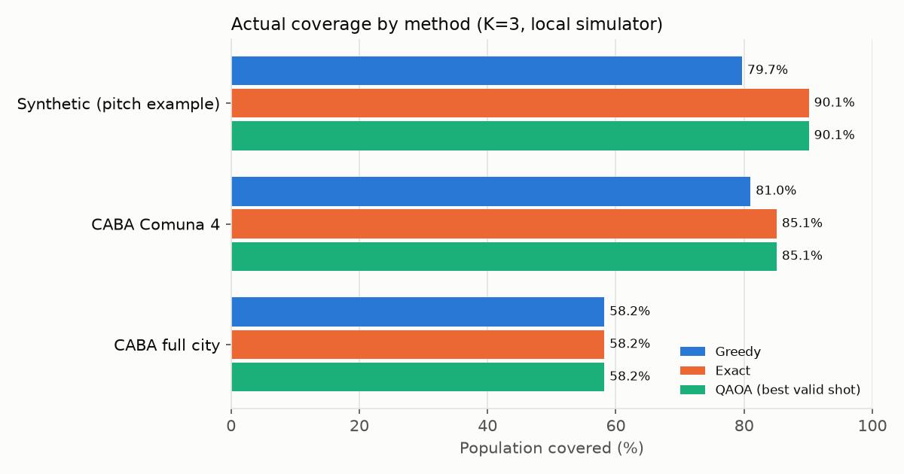
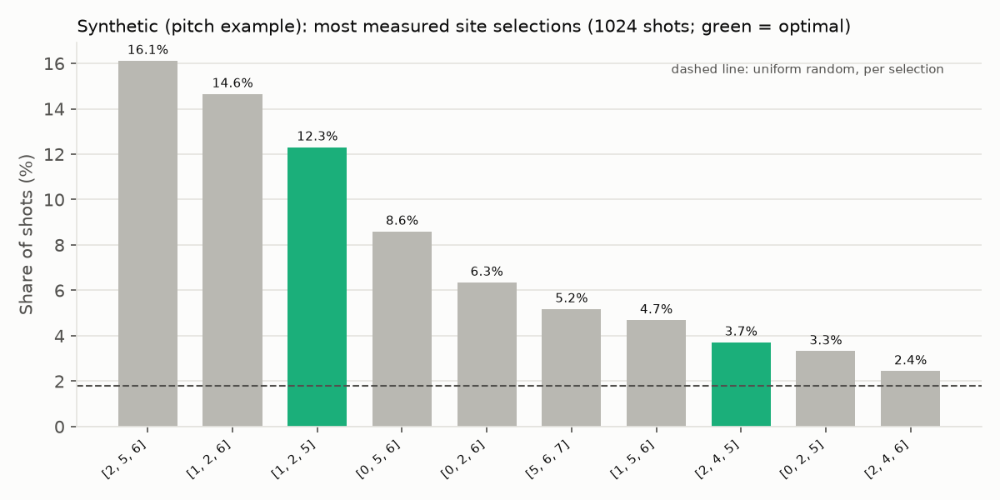
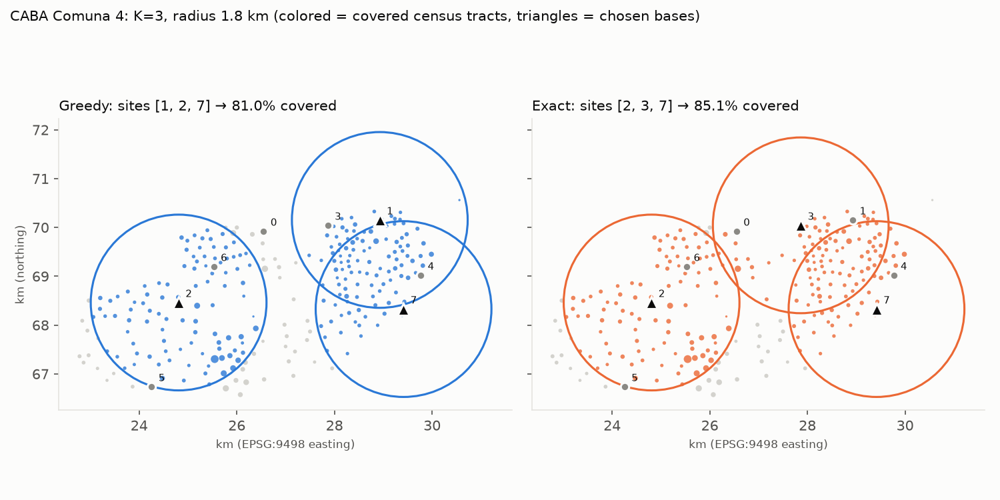
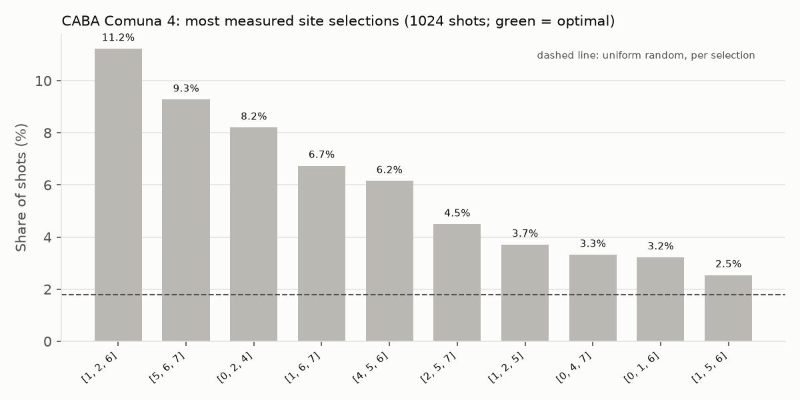

# Quantum Ambulances: placing emergency bases with QAOA

> Qollab x IonQ hackathon · Quantum Impact track
>
> **Fill before submitting:** Qollab project link: `TODO` · Video (public, 2–3 min): `TODO` · Source revision (git commit): `TODO` · Team: `TODO`

## The problem

A city has only a few ambulances and many places where it could station them.
Where they go decides how many people can be reached within a few minutes.
Given population-weighted zones, candidate base sites, a coverage radius and
exactly **K** ambulances, we choose the K sites that maximize the population
within the radius of at least one base (a *maximum coverage* problem). The
number of options grows fast: 8 sites and 3 ambulances give 56 combinations;
100 sites and 10 ambulances give more than 17 trillion.

## Our approach

We solve the same instance three ways and compare them on the **same inputs**:

1. **Greedy**: repeatedly add the site that covers the most new people. Fast,
   but an early choice can lock it into a worse answer.
2. **Exact**: try every combination (possible only because instances are small).
3. **QAOA**: each candidate site is one qubit (1 = place a base there).
   - The cost is a quadratic approximation of coverage: reward each site's
     population and subtract pairwise overlaps so people are not counted twice.
   - Instead of a penalty for "exactly K bases", the circuit starts in a
     **Dicke state** (an even superposition of all ways to choose K sites) and
     uses an **XY mixer**, which *moves* an ambulance from one site to another
     without changing how many there are. Every measurement uses exactly K
     ambulances (100% valid shots in all our runs).
   - The 6 circuit angles (3 layers) are tuned classically with COBYLA on a
     local statevector simulation. Then **one** measurement job goes to the
     backend chosen in Qollab, which respects IonQ's one-job-per-run limit.
   - The final answer is the measured selection with the best **actual**
     coverage, not the best approximate cost.

## Data

- **Synthetic example**: 15 zones, 8 sites, K=3, radius 3 km (the original
  prototype).
- **CABA Comuna 4** (Buenos Aires): 252 census tracts (~218k people) and 8 real
  emergency institutions (hospitals and fire stations), K=3, radius 1.8 km. The
  8 sites were deliberately chosen to create a gap between greedy and exact, so
  this case is *not* an unbiased benchmark.
- **CABA full city**: 3,552 census tracts (~2.89M people) and 8 geographically
  spread hospitals, K=3, radius 3 km. With only 3 bases, at most 58% of the city
  can be covered.

Population is the 2010 census count per tract, used as a proxy for demand.
Coordinates are projected to kilometres (EPSG:9498).
Source: GCBA Datos Abiertos / INDEC, Censo Nacional 2010 (CC-BY-2.5-AR).

## Results

### Reference runs (local simulator)

These come from Qiskit's local `BasicSimulator` (1,024 shots), run through the
same code path the Qollab app uses (`tools/reference_runs.py`). They are **not**
Qollab or IonQ results.

| Case | Greedy | Exact | QAOA best shot | P(optimum), QAOA | P(optimum), random | Amplification |
| --- | ---: | ---: | ---: | ---: | ---: | ---: |
| Synthetic | 79.7% | 90.1% | 90.1% | 16.0% (26.6%*) | 3.6% | 4.5× (7.4×*) |
| CABA Comuna 4 | 81.0% | 85.1% | 85.1% | 1.8% | 1.8% | 1.0× |
| CABA full city | 58.2% | 58.2% | 58.2% | 10.4% (41.1%*) | 1.8% | 5.9× (23×*) |

\* With a larger angle-optimization budget (4 restarts × 500 iterations, as in
the original prototype) instead of the app's default (2 × 150). Full table:
`docs/results/REFERENCE.md`.






**What this shows, and what it does not:**

- On the synthetic example, greedy misses the optimum. QAOA samples the optimum
  4.5–7.4× more often than random selection, and every shot uses exactly 3
  ambulances. With the app's default budget, though, the single most measured
  selection is still greedy's answer `[2, 5, 6]` (16.1%); the two tied optima
  together get 16.0%.
- On **CABA Comuna 4**, greedy again misses the optimum (81.0% vs 85.1%, about
  8,900 people). QAOA's best shot reaches the optimum, but QAOA does **not**
  amplify it. It concentrates probability on other, suboptimal selections (top:
  `[1, 2, 6]` at 11.2%), and the optimum `[2, 3, 7]` appears only about as often
  as by chance (1.8%). With 1,024 shots over only 56 possible selections,
  finding the optimum in the best shot is expected, so that alone is not
  evidence that QAOA works. We checked that the pairwise cost
  ranks the true optimum first in all three cases, so the weakness is in the
  shallow circuit and angle tuning, not in the objective. Our unverified guess is
  that the options are too close in coverage for 3 layers to separate.
- On the **full city**, QAOA amplifies the optimum strongly (up to 23×), but
  greedy already finds it, so there is no gap between methods to show.
- With 8 qubits, exhaustive classical search solves every case instantly. These
  runs measure solution quality and sampling behaviour, **not a speedup**. No
  quantum advantage for this problem class has been demonstrated.

### Qollab runs

The following are example runs done on the pre-loaded 'CABA - Comuna 4' dataset on the [Qollab project](https://qollab.xyz/u/rpetey317/ambulance-localizer):

| Backend (Select QPU) | Shots | Valid exactly-K shots | QAOA best coverage | P(optimum) | Backend job time |
| --- | ---: | ---: | ---: | ---: | ---: |
| Built-in simulator | 256 | 256 (100%) | 85.1% | 3.9% | 0.053s |
| IBM noise model (Boston) | 64 | 26 (40.6%) | 81.4% | 0.0% | 34.741s |
| IonQ simulator (Aria 2) | 64 | 14 (21.9) | 83.7% | 0.0% | 14.701s |

## How to run it on Qollab

1. Open the project and press **Run**. In *Select QPU*, pick a backend. The
   free built-in simulator is instant; IonQ simulators are remote and slower.
2. Choose a case (synthetic, CABA Comuna 4 or full CABA). Greedy and exact
   results update immediately.
3. Optionally drag candidate sites, edit coordinates, add or remove sites (max
   8), or change K and the radius. Classical results refresh, and any previous
   quantum result is marked **stale**.
4. Set shots (up to 4,096; up to 128 on IonQ simulators) and run QAOA. The panel
   shows the selected sites, actual coverage, valid exactly-K shots, P(optimum)
   versus random, and the measured distribution. Local angle tuning and backend
   job time are reported separately.
5. **One quantum job per Run on IonQ.** To sample again, copy the case JSON,
   press Stop, start a new Run and restore it.

## How to run it locally

Everything below is local-only; no remote jobs are submitted.

```bash
python -m pip install -r requirements.txt   # qiskit==2.5.2, numpy, scipy
```

- **Original prototype** (~1–2 min): `python baseline.py` prints greedy, exact
  and sampled QAOA results on the synthetic 8-site case, all on the local
  statevector. Edit `ZONAS`, `SITIOS`, `RADIO_KM` or `K` at the top of the file
  to experiment, then rerun.
- **Interactive UI**: `python -m tools.preview_ui`, then open
  `http://127.0.0.1:8765` (Ctrl+C to stop). A localhost-only QA harness serving
  the real Python bridge: the map editor, all datasets, greedy/exact previews
  and a quantum button backed by local `BasicSimulator`. Do not use it inside
  Qollab.
- **Test suites**: `python -m unittest discover -s tests -v` (Python core and
  adapter) and `npm test` (UI controller/model tests; Node only, no build
  step). For browser-level UI checks with Playwright and installed
  Chrome/Chromium, see `docs/UI.md`.

## Limitations and next steps

- **Scale**: one qubit per candidate site; classical simulation is comfortable
  up to roughly 20–25 qubits.
- **Angle optimization** uses exact statevector simulation, which does not
  scale. Larger instances would need on-hardware tuning or angle transfer from
  small problems.
- **Shallow circuit**: 3 layers did not amplify the optimum on CABA Comuna 4.
  More layers, cost rescaling or warm starts are open experiments.
- **Simplified model**: coverage uses straight-line distance within a radius,
  not road travel time. Demand is a static census population. This is not an
  operational dispatch tool, and the radius is not an emergency response time.
- **Curated sites**: real cases use 8 hand-curated candidates to fit 8 qubits.
- **Next**: road travel times (e.g. OSRM), time-varying demand, real ambulance
  base locations, more layers and instances, and tests on IonQ hardware.

## Credits and disclosures

- **Team**: `TODO` (names and roles).
- **Prior work**: the original prototype (`baseline.py`) and Spanish pitch
  (`Idea.pdf`) were prepared at the start of the hackathon. `TODO: confirm
  whether any code existed before the hackathon.`
- **AI assistance** (as recorded in the repository):
  - OpenAI Codex: core model, QAOA adapter, bridge and UI (`docs/CONTRACT.md`,
    `docs/UI.md`).
  - Devin: data pipeline and CABA cases (PR #10).
  - Claude Code: test suite and CI (PRs #11, #14), reference runs and this page.
  - `TODO: confirm AI use for baseline.py / the pitch.`
- **Data**: GCBA Datos Abiertos / INDEC, Censo Nacional 2010, CC-BY-2.5-AR.
- **Software**: Qiskit, NumPy, SciPy. **License**: MIT (`LICENSE`).
