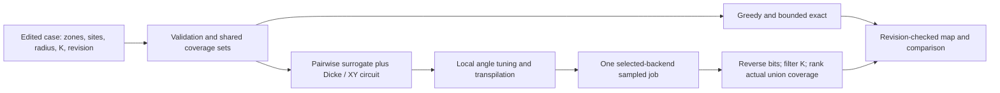

# Business hypothesis, pilot and short judge answers

These are proposals and interview questions, not customer commitments or achieved results.

## The buyer and first offer

Target an EMS operations/planning director responsible for base location, fleet allocation and service access. SAME in Buenos Aires is one prospective organization; the public [institutional remit](https://buenosaires.gob.ar/perfil_institucional/direccion-general-sistema-de-atencion-medica-de-emergencia-same) supports the role, not a relationship. A private ambulance operator's COO is another possible buyer. Confirm the budget owner in discovery.

Offer a small **retrospective planning evaluation** before discussing integration with dispatch. Test whether an operator struggles to compare and justify site proposals under limited resources. Do not assume that pain: ask for the most recent actual placement decision, what tools were used, hours spent, rejected options and the outcome. Request a 30-minute conversation through the published institutional channel. No outreach has been sent as part of this work; the emergency 107 line is not a sales channel.

If a problem and data access are established, propose a paid, bounded pilot followed by an annual planning-software license. Selling a better decision process is the hypothesis; quantum sampling remains a benchmark branch until it demonstrates operator value. Incumbent CAD tools and existing optimizers are serious alternatives.

## Economics that can be tested

The $5.3bn Medicare number in the speech is external payment context. A defensible software market estimate must instead use verified reachable operators, willingness to pay, procurement eligibility and integration cost.

For planning only, assume a **$30,000 annual license** and **$10m operator budget**: the license alone would require **0.3%** verified annual budget-equivalent benefit to break even. Include integration/support costs before claiming ROI. These are invented sensitivity inputs, not observed prices or a SAME budget.

| Hypothetical annual cost | Budget | Benefit required to break even |
| --- | --- | --- |
| $30,000 license | $5m | 0.60% |
| $30,000 license | $10m | 0.30% |
| $30,000 license + $50,000 first-year integration | $10m | 0.80% |

At that untested price, 100 retained operator customers would mean $3m annual recurring revenue; 1,000 would mean $30m. Those are arithmetic scenarios, not a market-size estimate or sales forecast. No willingness-to-pay evidence exists yet.

Measure avoidable paid vehicle-hours, costed empty relocation and planning labor with the operator's own accounting. Preserve service access and shift feasibility; moving bases can raise costs. Budget improvements are not cash savings until resources can actually be released or redeployed usefully.

There is no justified “lives saved” projection today. A future analysis could use eligible incident count times a clinically validated absolute outcome difference, with uncertainty and confounding addressed. **8,890 extra residents inside a radius cannot be multiplied by a published survival percentage** to produce saved lives.

## Proposed pilot gates

| Gate | Work | Evidence needed to continue |
| --- | --- | --- |
| Discovery, weeks 1–2 | Interview planning owner; document current tools, specific decision pain and budget ownership. | Real problem and willingness to allocate evaluation time. Stop if absent. |
| Data/model, weeks 3–4 | Agree permitted historical calls, time periods, candidate feasibility, actual bases, fleet/shift availability and road-time matrix. | Data permission, usable quality and a credible current-plan baseline. Stop if infeasible. |
| Retrospective benchmark, weeks 5–8 | Train/tune on earlier periods; test on held-out periods. Compare current plan, greedy, mixed-integer/other strong classical methods and any feasible quantum branch. | Access/response metrics with uncertainty; feasible proposed changes; full compute and operating costs. |
| Shadow evaluation, weeks 9–12 | If retrospective results justify it, review recommendations without changing live dispatch. | Operator acceptance, no unacceptable neighborhood/shift degradation, documented integration cost and willingness to pay. |

This schedule is proposed. Real deployment or outcome studies may need a different scope and additional review.

Pre-register operational metrics: median and 90th-percentile response time; fraction of calls within an **operator-defined** service target; neighborhood tail/access distribution; vehicle-hour and relocation cost. A radius-to-centroid percentage is the current demo metric, not a substitute for these.

## Answers to rehearse

**Why quantum if exact already wins?** “Exact is the truth reference at eight sites. QAOA is our constrained-sampling experiment. We have not established an advantage; future operator decisions should use whichever verified method offers the best quality and total cost.”

**Why Dicke and XY?** “The decision requires exactly K selected sites. Dicke starts inside that feasible subspace; the XY mixer preserves excitation count on noiseless runs. We also filter measured samples, since noise and backend behavior can violate the intended constraint.”

**Does your cost equal population coverage?** “No. Local tuning uses a pairwise approximation. We select and compare measured solutions with the actual union of covered zones, so overlaps count once.”

**How many lives have you saved?** “None demonstrated. We have a modelled coverage result. The proposed pilot first tests actual access and response; survival requires clinical evidence.”

**How much money does the demo save?** “No measured saving yet. It changes the compared covered population while holding three selected bases fixed. Operator costs must be evaluated before projecting ROI.”

**Is 8,890 a quantum gain?** “It is exact versus greedy on a curated case. The local sampled quantum run can be compared with that reference; the number does not establish quantum superiority.”

**Is it biased?** “The compact eight-site subset was selected to expose a greedy gap. We disclose that choice and also show full-city equality. A pilot needs representative or pre-registered candidate sets.”

**Why show 2010 data?** “It is the packaged public tract-level dataset we processed. The case format allows other weights. Planning validation needs current calls and road times.”

**Does it run on IonQ hardware?** “This recording uses local BasicSimulator. The adapter accepts a supplied backend, but this kit does not establish a remote or hardware run.”

**Does 3,552 zones mean 3,552 qubits?** “No. Qubits correspond to candidates: eight here. Zone count changes coverage resolution, not the candidate combinatorial search.”

**What is the moat?** “None established. The code is MIT and existing vendors address planning. Operator relationships, trustworthy integrations and demonstrated decision value could create a business, but those must be earned.”

**What did you build for the hackathon?** “A shared validated case/result contract, reproducible coverage baselines, an editable revision-aware map, and dynamic exactly-K QAOA sampling with one selected-backend job and honest metrics. Local checks pass; actual platform execution needs its own evidence.”

**What do you want from the judges?** “An introduction to one operator planning team willing to examine a retrospective pilot.”

## Architecture for technical follow-up

This is the implemented research workflow. Call histories, road-time matrices, real fleet availability and live-dispatch integration are future pilot inputs/features, not blocks hidden behind the current map.
